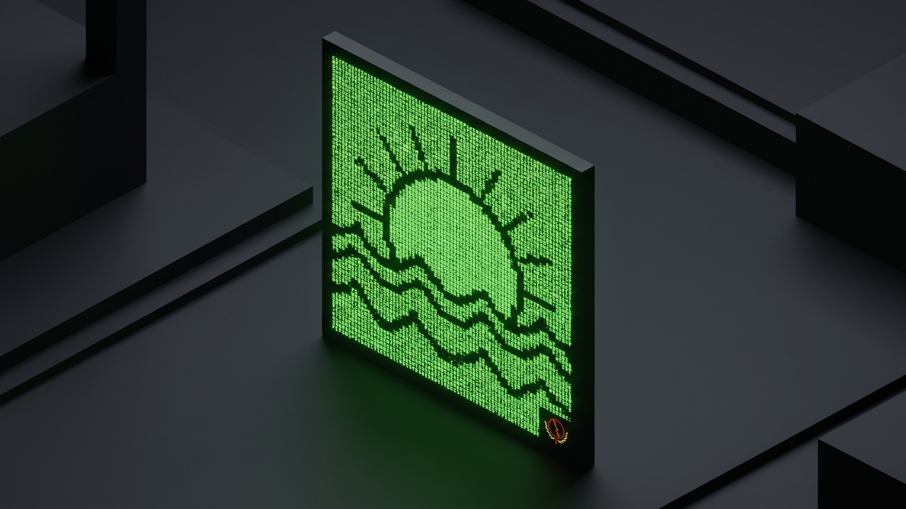
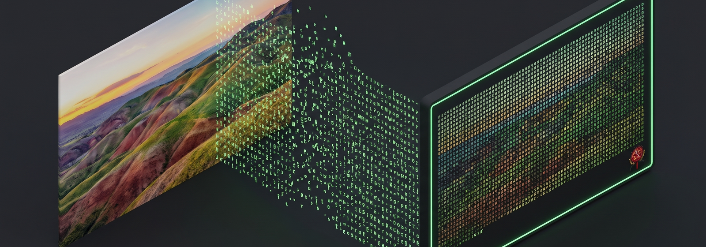

<p align="center"></p>

# ASCII-Art-Generator

**The Phosphor Blockworks**
_Pictures rebuilt block by block, in green light on charcoal._

ASCII generated art: block-letter text banners and image-to-ASCII conversion.
Small enough to include in a shell start config.

<p align="center"></p>


> Bench note, stamped in phosphor: the bench below is laid out block by block, banners first, then photographs, then the library shelf.

## Get the tool

```sh
git clone https://github.com/Epsilon0xCell/ASCII-Art-Generator.git
```

No required dependencies: images are read with Pillow when it is installed, and Netpbm files are read natively without it (see Image to ASCII).


## Text banners


```sh
python3 ascii_art.py banner "HELLO"
python3 ascii_art.py banner --double "HI"   # double-width glyphs
```

Output:

```
█  █ ███
█  █  █
████  █
█  █  █
█  █ ███
```

The font covers A-Z, 0-9 and basic punctuation (`.,!?-+'":/*_#` and space).
Input is uppercased first; any other character renders as a space.

Shell startup example (`.bashrc` / `.zshrc`):

```sh
python3 ~/ASCII-Art-Generator/ascii_art.py banner "WELCOME"
```


## Image to ASCII


```sh
python3 ascii_art.py image photo.png
python3 ascii_art.py image photo.png --width 120 --invert
```

- `--width` sets the output width in characters (default 80); height is
  scaled automatically with terminal character aspect correction.
- Images are read with Pillow when installed (PNG, JPEG, GIF, BMP, ...).
  Without Pillow, Netpbm files (PGM/PPM, plain or raw) are read natively,
  so the tool still works with zero dependencies.


## Library use


```python
from ascii_art import banner, image_to_ascii

print(banner("CODE"))
print(image_to_ascii("photo.png", width=100))
```


## License


MIT (see LICENSE).
